# ADR-0007: Advisory Semantic Decisions Remain Outside Purchase Authority

## Status

Proposed — evaluation boundary only. No live model integration or external household-data transfer is approved by this ADR.

## Context

The canonical pipeline preserves receipt/order evidence, creates untrusted raw import rows and purchase candidates, and requires explicit approval before an immutable authoritative Purchase exists. Stock estimates, budget exports, and recommendations are recomputable derived outputs. ADR-0006 fixes the public-code/private-Cloudflare boundary.

Receipt abbreviations and lookalike items create ambiguous product identity and unit/category interpretation. A typed decision model such as TypeSafe Jev might reduce review effort, but its typed result and probability are not guarantees of correctness. A local classifier or deterministic rules may be sufficient. JEPA-style predictive representations address a different research problem and do not change acquisition truth.

## Decision

Evaluate semantic decision models, including Jev, **only as optional advisory interpretation providers** for the existing normalization/review pipeline. The default path remains deterministic, with unknown/needs-review behavior on failure or uncertainty. No provider is selected or approved for production by this record.

The provider receives a bounded choice set generated from existing canonical aliases/items and produces a **proposed** choice or abstention. It cannot invent catalog IDs or directly change persistent authoritative state.

```mermaid
flowchart LR
  Evidence[Private immutable raw evidence] --> Normalizer[Deterministic normalization]
  Normalizer --> Candidates[Bounded catalog candidate shortlist]
  Candidates --> Advisory[Optional semantic decision provider]
  Advisory --> Validate[Validate IDs, score shapes and policy]
  Validate --> Proposal[Untrusted candidate suggestion]
  Normalizer --> Proposal
  Proposal --> Review[Existing explicit review / approval]
  Review --> Purchase[(Immutable Purchase ledger)]
  Purchase --> Derived[Recomputable stock / budget / planning]
```

### Authority

1. The canonical evidence / `ImportRawRow` record is never overwritten based on a model result.
2. Only inventory-bearing `item` lines may yield purchase candidates under existing schema/policy.
3. Existing review-event and promotion boundaries apply unchanged. Model advice is **not** an approval or an actor.
4. Exact-evidence idempotency and transaction similarity are governed by #13; model output cannot confirm duplicates, suppress evidence, bypass duplicate-review blocks, or supersede a Purchase.
5. Aliases/category mappings remain proposals until accepted by existing human-authorized processes; no autonomous ontology mutation.
6. Manual overrides and explicit `unknown` remain authoritative over advisory derived stock, and the model cannot silently modify them.

### Isolation and failure behavior

- The domain uses a provider-neutral evaluation contract, not TypeSafe-specific transport/response types.
- Candidate shortlist construction, unit sanity checks, uncertainty thresholds and allowed state transitions are deterministic application policy.
- Returned identifiers must exist in the supplied shortlist; incomplete, unexpected, non-finite or out-of-range probabilities are rejected.
- A closed-set API must include an explicit `unknown/no_match` choice where feasible; if none is available or the provider abstains, route to review.
- Timeouts, throttling, unavailable credentials, invalid output and provider errors cause no persistent mutations and retain normal deterministic review behavior.
- Record only model ID/version, provider adapter version, benchmark configuration, synthetic fixture IDs and non-sensitive decision metrics in public evaluation outputs.
- A production provider, if eventually introduced, requires bounded timeouts/cost, circuit breaking or equivalent fast fallback, observability and feature disable/rollback.

### Privacy and security boundary

This is a **public repository**. No real receipt images, OCR, order messages, baskets, household purchasing patterns or sensitive derived attributes may be placed in source, synthetic fixtures, issue bodies, PRs, CI artifacts or evaluation traces.

Public CI/evaluations are synthetic and credential-free. Live model calls are opt-in, separate from required CI, and operate only on materially synthetic fixtures under this ADR.

Before any real private household data is sent to a remote vendor, require a *separate* documented security/privacy decision: vendor terms and retention/training, processor jurisdictions, fields minimized, credentials/scope, authorization, abuse controls, deletion/incident response and explicit operator approval. An authenticated Worker does not by itself authorize third-party transmission. Local inference should still be sandboxed and least-privilege.

Treat all external model results as untrusted input, including probabilities and strings, and prevent prompt/control injection from altering deterministic rules.

## Alternatives considered

- **Deterministic alias/category/unit normalization:** required baseline; simplest and cheapest with explainable failure modes.
- **Local embedding/classifier:** eligible benchmark contender; avoids an external processor but introduces model maintenance/runtime cost.
- **Jev typed Choice/Score/Noul:** eligible benchmark contender for bounded judgments; remote hosted data boundary and external dependency make immediate adoption inappropriate.
- **Generative LLM:** eligible as a secondary benchmark only if needed; output parsing, latency, and broader behavior must be measured rather than assumed.
- **JEPA-style stock forecasting:** deferred to separate research. Existing receipt data does not observe consumption or possession.

## Consequences and exit criteria

- #42 defines an offline reproducible benchmark against deterministic baselines using synthetic fixtures owned/expanded by #4.
- A benefit must be shown with false-match/selective-risk, coverage/abstention, calibration, review-workload, cost, and reliability evidence; a best-case accuracy claim is insufficient.
- Passing a benchmark **does not** enable automatic promotion or real-data inference. A production integration requires its own issue, privacy review, and amendment/new accepted ADR.
- If there is no measurable benefit or the privacy/operational burden outweighs it, retain the deterministic workflow.

## Related decisions and specs

- [ADR-0006: Public code and private substrate](ADR-0006-public-code-private-cloudflare-substrate.md)
- [Normalization pipeline](../specs/normalization-pipeline.md)
- [Evaluation plan](../specs/semantic-normalization-evaluation.md)
- [Private data policy](../security/private-data-policy.md)
- [JEPA feasibility assessment](../research/jepa-stock-prediction-feasibility.md)
- Issues [#4](https://github.com/ryjen/shopping-inventory/issues/4), [#13](https://github.com/ryjen/shopping-inventory/issues/13), and [#42](https://github.com/ryjen/shopping-inventory/issues/42).

## References

- TypeSafe Jev: https://docs.typesafe.ai/introduction
- Meta V-JEPA 2/2.1 reference implementation: https://github.com/facebookresearch/vjepa2
