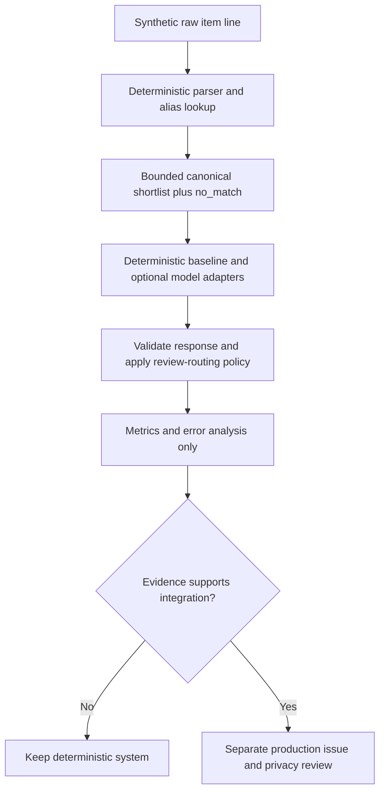

# Semantic Normalization Evaluation: Provider-Neutral Benchmark

**Status:** Proposed, offline experiment only  
**Tracking:** [#42](https://github.com/ryjen/shopping-inventory/issues/42)  
**Policy:** [ADR-0007](../decisions/ADR-0007-advisory-semantic-decision-boundary.md)

## Question and decision

Does any bounded semantic decision provider reduce ambiguous item identity/quantity/category review effort relative to existing deterministic normalization, **without** increasing incorrect confident matches or violating the canonical authority model?

First compare deterministic alias and unit rules with the existing review fallback. Jev and a small local classifier/embedding matcher are experimental contenders, not mandatory dependencies. Do not add a provider to production merely because it returns typed probabilities.

The task concerns proposed normalization of a single already-validated `ImportRawRow`; image OCR, transaction identity, duplicate-resolution policy, inventory truth and purchase approval remain separate.

## Data and trust flow



Run the experimental adapters outside the canonical Worker mutation path. Public CI executes deterministic harness/tests only with synthetic data, including captured/frozen opt-in model responses for regression. No API keys or network dependency in required CI.

## Workloads

### Task A: bounded canonical identity matching (primary)

Given an extracted, non-sensitive *synthetic* line plus a deterministic shortlist of candidate canonical item IDs, choose one candidate or `no_match`. Do not supply a free-text catalog-generation answer. Distinguish category/product family, package size and units; do not silently convert incompatible quantities.

### Task B: review routing (secondary)

Given a proposed match, deterministic parse confidence, unit contradictions, and duplicate/policy flags, decide whether to preserve `needs_review` or abstain. Do **not** replace existing hard policy gates with a model score; this measures recommendation value only.

### Task C: optional future ranking

A separate study may score deal relevance for #24; do not conflate its business metrics with normalization accuracy or use its results as justification for Purchase changes.

## Evaluation contract (conceptual, not a production schema)

Use a harness-local versioned contract so models are replaceable and source/import contracts are unaffected.

```typescript
type EvaluationCase = {
  caseId: string;              // invented, stable synthetic ID
  synthetic: true;
  rawLine: string;             // invented, not derived by redaction
  parsedQuantity?: string;
  candidateIds: string[];      // deterministic ordered shortlist
  expectedId: string | null;   // independent gold truth: null = no_match/unknown; non-null may be absent from candidateIds
  hardFlags: string[];         // e.g. unit_conflict, review_required
  cohort: string;              // taxonomy defined below
};

type Decision = {
  selectedId: string | null;   // null = no_match / abstention
  probabilities?: Record<string, number>;
  abstained: boolean;
  modelId: string;
  adapterVersion: string;
  elapsedMs?: number;
};
```

The validation layer rejects a returned ID outside `candidateIds`, duplicate IDs, invalid option distributions, unexpected keys or non-finite numbers. A model's `confidence` field is not presumed to equal empirical probability. Preserve raw provider results privately if collected; public evaluation output must be synthetic and payload-minimal.

Jev adapter shape when trialed: send bounded synthetic context as `state` with a `choice` question whose criteria are the candidate IDs **plus** `no_match`. Consider independent `noul`/ `score` questions only when they answer distinct atomic questions. Pin the exact model/API version, capture question text and option ordering. Prefer the official TypeSafe API documentation over third-party gateway examples.

## Synthetic fixture design

Expand the existing [evaluation corpus](../../evaluation/README.md) as part of #4. Include at least these cohorts, with stratified counts documented before model comparison:

| Cohort | Intended challenge |
| --- | --- |
| Unambiguous alias | Existing rule should already pass |
| Abbreviation/typo | Legitimate variant of canonical name |
| Near-identical packaging | Same family, different size or unit |
| Lookalike product | Wrong variant/category should be rejected |
| Unknown/no catalog match | Correct abstention instead of invention |
| Missing or contradictory quantity | Review must remain available |
| Untrusted embedded instruction | External text cannot alter rules |
| Hard-policy review | Duplicate/sensitive/unreconciled items cannot bypass mandatory review |

Do not use a real receipt copied and redacted. Invent names, baskets, identifiers, dates and prices. Include both positive and negative pairs and deliberately unseen catalog identities. Explicitly separate normalization errors from extraction errors, and do not import #13 fingerprint identity or resolution into this benchmark.

### Split and leakage controls

- Freeze gold labels and held-out cases **before** tuning thresholds, prompts or candidate generation.
- Split by canonical item family/alias template where feasible, not merely by randomized rows, to avoid near-duplicate leakage.
- Evaluate at least two candidate orders for Jev (and any order-sensitive provider); randomization must be seeded and recorded.
- Do not optimize on the test split. Keep tuning/validation/test partitions separate; if the corpus is too small, report that limitation.
- Record fixture/spec revisions and deterministic normalization commit hash.
- A starting target is at least 100 materially synthetic, diverse cases, with the cohort breakdown explicitly reported. A small passing suite is **not** statistical proof of production safety.

## Baselines and experiments

1. **Rules-only:** existing normalization + conservative review.
2. **Rules + lexical retrieval:** optional lightweight fuzzy/TF-IDF matcher, if not already represented in baseline.
3. **Local contender:** a small classifier or embedding similarity ranker if it fits the implementation budget.
4. **Jev:** opt-in hosted trial, synthetic inputs only.
5. **Generative model:** only if required to establish a useful comparator; bound output to same candidate set.

Use identical candidate shortlists and case splits when comparing selection models. **Gold truth must remain independent of retrieval:** a known catalog item may be absent from `candidateIds`. Score this as a retrieval miss, not as an invalid fixture, and prohibit any provider from selecting an ID outside the supplied shortlist. Measure retrieval recall separately from selective precision, including held-out cases where the correct item was not retrieved; otherwise poor shortlist coverage can be misattributed to the model. Use **separate outcome metrics**: end-to-end scores include retrieval failures and mandatory policy vetoes, conditional selection scores include only cases where gold is retrievable (or genuinely no-match) and exclude policy vetoes, and unreachable-shortlist diagnostics count provider abstentions versus false selections. A correct abstention on unreachable gold must not be scored as a selection-stage miss.

## Metrics and decision gates

| Measure | Definition / concern |
| --- | --- |
| False-positive identity match | Wrong non-null canonical ID, especially wrong package/size |
| Selective precision and risk | Accuracy/error among non-abstentions, at reported coverage |
| Coverage/abstention | Fraction resolved vs sent to review |
| Recall@k of shortlist | Fraction of cases with a known, non-null catalog gold item where its ID was present in the candidate shortlist; exclude true no-match cases from denominator |
| Review workload | Expected manual decisions avoided or wrongly induced |
| Calibration | Brier score / reliability bins / ECE on supported probabilities; report sample limits |
| Stability | Repeats, candidate-order perturbations, timeout/error paths |
| Performance and cost | p50/p95 latency, estimated per-1k-line cost, operational dependencies |

Prefer a **risk–coverage curve** rather than a single confidence threshold. Set thresholds on the validation split, never on held-out test cases. Report uncertainty intervals where meaningful. Keep a failure taxonomy and inspect high-confidence wrong answers.

**Adoption gate:** A contender must demonstrate a measurable review-workload benefit at no observed increase in critical false-positive matches on the predeclared held-out set, pass all existing hard-policy tests, and justify privacy/availability/maintenance costs. Since finite tests cannot establish zero risk, this only authorizes consideration of a follow-up integration issue, not automatic matching or approval. A result that is equivalent or worse than rules means no new runtime dependency.

## Negative and failure-path verification

- Simulate provider timeout, 429/5xx, credential absence, response truncation/invalid shape and candidate-ID mismatch.
- Confirm that all such outcomes remain reviewable; raw rows, aliases, review events, duplicate events and purchases are unchanged.
- Confirm no provider result can change #13 duplicate disposition or bypass required reviewer attribution.
- Check adversarial receipt text that poses as instructions, misleading quantities, unicode confusables and ambiguous package descriptors.
- Guard against accidental leakage through test logs, model prompts, telemetry and generated markdown/JSON artifacts.
- Test candidate ordering and question wording changes as versioned behavioral inputs.

## Reproducibility, deliverables, and close criteria

Proposed future harness entry point: `npm run eval:semantic` (not yet implemented). The command should run offline without credentials, use frozen responses for external contenders, and emit aggregated machine-readable and Markdown reports without private line content. Live benchmark execution, if supported, must be an explicitly separate opt-in command.

Deliver:
1. Versioned synthetic evaluation cases, expected IDs, splits and taxonomy, aligned with #4.
2. Deterministic baseline + fixture validator + frozen-model replay.
3. Side-by-side error and calibration/coverage report with costs and risks.
4. Explicit **adopt / reject / insufficient evidence** decision, including whether a new integration/security issue is warranted.

Never store real household observations in the public repository, including failed runs or scratch files.

## References

- [Normalization pipeline](normalization-pipeline.md)
- [Review/audit semantics](../schema/review-and-audit-events.md)
- [Inventory estimates](inventory-decay-heuristics.md)
- [Private data policy](../security/private-data-policy.md)
- [TypeSafe official introduction](https://docs.typesafe.ai/introduction)
